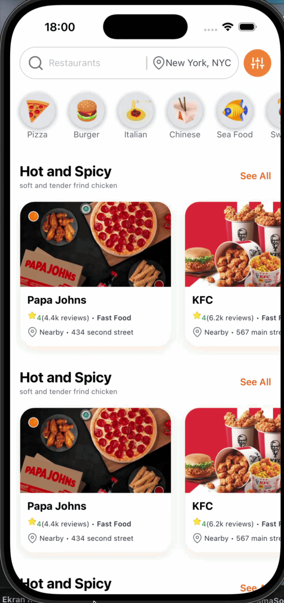

# 🍔 Food Delivery App

Modern ve kullanıcı dostu bir **React Native + Expo** tabanlı yemek sipariş uygulaması. Kullanıcılar restoranları keşfedebilir, kategorilere göre filtreleme yapabilir ve popüler yemekleri kolayca inceleyebilir.

## 📱 Preview



## ✨ Features

- 🔍 Restoran arama
- 📍 Konum seçme
- 🍕 Kategori bazlı filtreleme
- ⭐ Restoran puanları ve yorum sayıları
- 🍗 Popüler restoran listeleri
- 🎨 Modern ve responsive UI
- ⚡ Expo ile hızlı geliştirme
- 🌙 Native performans

## 🛠️ Tech Stack

| Technology | Version |
|------------|----------|
| React Native | 0.81.5 |
| React | 19.1.0 |
| Expo | 54 |
| React Navigation | 7 |
| Redux Toolkit | 2 |
| NativeWind | 4 |
| Tailwind CSS | 3 |
| React Native Maps | 1.20 |

## 📦 Dependencies

```json
{
  "@react-navigation/native": "^7.2.2",
  "@react-navigation/native-stack": "^7.14.12",
  "@reduxjs/toolkit": "^2.11.2",
  "expo": "~54.0.33",
  "nativewind": "^4.2.3",
  "react": "19.1.0",
  "react-native": "0.81.5",
  "react-native-feather": "^2.0.0",
  "react-native-maps": "1.20.1",
  "react-redux": "^9.2.0",
  "tailwindcss": "^3.4.19"
}
```

## 🚀 Installation

Repository'yi klonlayın.

```bash
git clone https://github.com/username/food-delivery-app.git
```

Proje dizinine girin.

```bash
cd food-delivery-app
```

Bağımlılıkları yükleyin.

```bash
npm install
```

veya

```bash
yarn install
```

## ▶️ Run Project

Expo Development Server'ı başlatın.

```bash
npm start
```

Android için

```bash
npm run android
```

iOS için

```bash
npm run ios
```

Web için

```bash
npm run web
```

## 📂 Project Structure

```
src/
│
├── components/
├── screens/
├── navigation/
├── redux/
├── assets/
├── constants/
└── utils/
```

## 🎯 Future Improvements

- ❤️ Favori restoranlar
- 🛒 Sepet sistemi
- 💳 Online ödeme entegrasyonu
- 👤 Kullanıcı kimlik doğrulama
- 📦 Sipariş takibi
- 🔔 Push bildirimleri
- 🌍 Google Maps API entegrasyonu
- 🌙 Dark Mode desteği

## 📸 Screenshots

| Home |
|-------|
|  |

## 🤝 Contributing

Katkılarınızı memnuniyetle karşılıyoruz.

1. Fork oluşturun
2. Yeni bir branch açın

```bash
git checkout -b feature/new-feature
```

3. Commit oluşturun

```bash
git commit -m "Add new feature"
```

4. Push edin

```bash
git push origin feature/new-feature
```

5. Pull Request oluşturun.

## 📄 License

Bu proje MIT lisansı altında paylaşılmıştır.

---

<p align="center">
Made with ❤️ using React Native, Expo & NativeWind
</p>